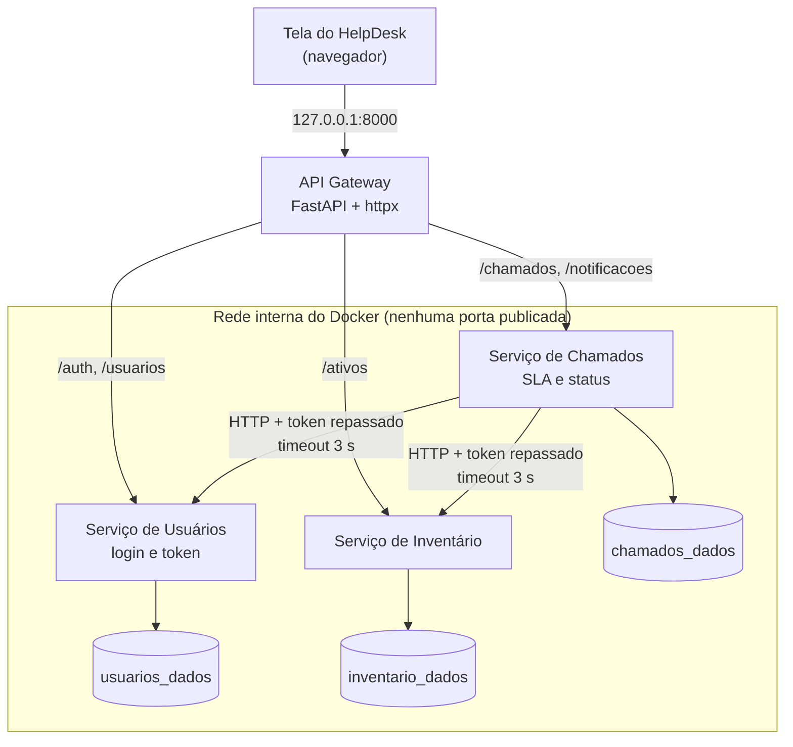

# HelpDesk TI em Microsserviços

> 🎥 **Vídeo de demonstração:** _cole aqui o link do vídeo (YouTube não listado ou Google Drive)_

O **HelpDesk TI** era um monólito: uma aplicação, um banco e uma implantação. Esta versão separa o sistema em **três serviços independentes**, cada um com o seu banco, atrás de um **API Gateway** que é o único ponto de entrada. As funcionalidades e as regras (SLA e transições de status) são as mesmas do monólito.

## Arquitetura



| Componente | Responsabilidade | Banco |
|---|---|---|
| **gateway** | Serve a tela, encaminha cada rota ao serviço certo, responde `503` se o serviço estiver fora do ar, expõe `GET /saude` | nenhum |
| **usuarios** | Cadastro de usuários, login e emissão do token | `usuarios_dados` |
| **inventario** | Equipamentos (ativos) | `inventario_dados` |
| **chamados** | Chamados, SLA, transições de status, comentários, painel e avisos | `chamados_dados` |

## Estrutura do repositório

```
.
├── docker-compose.yml
├── .env / .env.example
├── gateway/              # API Gateway (FastAPI + httpx) e a tela (app/web/)
├── usuarios/             # serviço de Usuários
├── inventario/           # serviço de Inventário
└── chamados/             # serviço de Chamados
```

## Como rodar

**Pré-requisito:** Docker com Docker Compose v2.

1. Crie o arquivo `.env` (o script `criar_gateway.py` já cria um com segredo aleatório; se preferir fazer à mão):

   ```bash
   cp .env.example .env
   python -c "import secrets; print(secrets.token_urlsafe(48))"   # cole o resultado em JWT_SEGREDO
   ```

   Sem `.env`, o `docker-compose.yml` usa valores padrão só para laboratório. **Nunca use o segredo padrão fora do laboratório.**

2. Suba tudo com um comando:

   ```bash
   docker compose up --build
   ```

3. Confira que todos os contêineres estão no ar:

   ```bash
   docker compose ps
   ```

4. Abra **http://127.0.0.1:8000** e entre com uma conta de exemplo (senha `Helpdesk2026`, ou o valor de `SENHA_EXEMPLO`):

   | E-mail | Perfil |
   |---|---|
   | `admin@empresa.com` | administrador |
   | `carla@empresa.com` | técnica |
   | `ana@empresa.com` | solicitante |

5. Para parar: `docker compose down` (os dados ficam nos volumes). Para apagar também os dados: `docker compose down -v`.

### Rotas do gateway

| Rota | Serviço de destino |
|---|---|
| `/auth/*`, `/usuarios*` | Usuários |
| `/ativos*` | Inventário |
| `/chamados*`, `/notificacoes*` | Chamados |
| `GET /saude` | O próprio gateway: consulta o `/saude` dos três serviços e devolve `online` ou `offline` de cada um |
| `/` (e arquivos da tela) | Tela do HelpDesk |

Exemplo de resposta de `GET /saude` com o Inventário parado:

```json
{"gateway": "online", "servicos": {"usuarios": "online", "inventario": "offline", "chamados": "online"}}
```

### Testando as falhas e a segurança

```bash
# sem token: 401
curl -i http://127.0.0.1:8000/chamados

# login e uso do token
TOKEN=$(curl -s -X POST http://127.0.0.1:8000/auth/login \
  -H 'Content-Type: application/json' \
  -d '{"email":"carla@empresa.com","senha":"Helpdesk2026"}' | python -c "import sys, json; print(json.load(sys.stdin)['access_token'])")
curl -s http://127.0.0.1:8000/chamados -H "Authorization: Bearer $TOKEN"

# derrubar o Inventário: usuários e chamados continuam; abrir chamado com equipamento dá erro claro
docker compose stop inventario
curl -s http://127.0.0.1:8000/saude
docker compose start inventario

# bancos separados: um volume por serviço
docker volume ls | grep _dados
docker compose exec usuarios ls -l /dados
docker compose exec chamados ls -l /dados
```

Na tela, a **barra de status do cabeçalho** consulta `/saude` a cada 5 segundos: o indicador de cada serviço fica verde (online) ou vermelho (offline).

## Decisões arquiteturais

| Decisão | Motivo | Contrapartida |
|---|---|---|
| **Um banco por serviço** (SQLite em um volume próprio) | Cada serviço é dono dos seus dados; nenhum lê ou grava no banco de outro. As chaves estrangeiras entre serviços viraram simples IDs, conferidos por HTTP. | Não há mais `JOIN` nem transação entre serviços: a consistência passa a ser responsabilidade da aplicação. |
| **Chamadas síncronas por HTTP** de Chamados para Usuários e Inventário, com **timeout de 3 s** | É a forma mais simples de trocar o antigo "chamar uma função" por "chamar pela rede", e o resultado é imediato. | Chamados passa a depender da rede e da disponibilidade dos outros dois. |
| **Falha clara em vez de travar** | Se Usuários ou Inventário não responderem, Chamados devolve `503` com mensagem legível. A tela mostra o erro e continua carregando o que está no ar. | O usuário precisa tentar de novo depois. |
| **Gateway próprio em FastAPI + httpx** (e não Nginx) | Mesma linguagem do resto do projeto, fácil de ler e de testar. Dá para ter o `/saude` agregado e as mensagens de erro em português. | Menos recursos de produção que um Nginx pronto (cache, limite de taxa). |
| **Lista permitida de cabeçalhos no gateway** | Só `Authorization`, `Content-Type`, `Accept` e `Accept-Language` seguem para os serviços. O que vem de volta também é filtrado. | Se um serviço precisar de outro cabeçalho, é preciso liberar no gateway. |
| **O gateway não confere o token** | Ele repassa o `Authorization` como está. Quem decide é cada serviço, então não existe um caminho que "pule" a verificação. Por isso o gateway nem recebe o `JWT_SEGREDO`. | Cada serviço repete a verificação (reaproveitando o código de `app/auth/`). |
| **Segredo JWT compartilhado (HS256)** | Todos os serviços validam o mesmo token sem chamar o serviço de Usuários a cada requisição. | Quem vazar o segredo em um serviço consegue emitir tokens para todos. Com mais tempo, o caminho seria chaves assimétricas (RS256), em que só Usuários assina. |
| **Token repassado nas chamadas entre serviços** | Chamados age em nome do usuário, então as permissões continuam valendo nos outros serviços. | Um token expirado no meio de uma operação falha a operação inteira. |
| **Rede `backend` interna** e só o gateway em `127.0.0.1:8000` | Serviços e bancos não são alcançáveis de fora do Docker e também não saem para a internet. | Para depurar um serviço direto é preciso `docker compose exec`. |
| **Contêineres endurecidos** | `uid 10001` (sem root), `read_only: true`, `tmpfs` em `/tmp`, `cap_drop: ALL`, `no-new-privileges` e limite de processos. A única área gravável é o volume `/dados` de cada serviço. | Cada imagem precisa criar `/dados` já pertencente ao `uid 10001`. |
| **Segredos no `.env`** | `JWT_SEGREDO` nunca está no código; o `.env` fica fora do Git. | O valor padrão do `docker-compose.yml` existe só para o laboratório rodar sem configuração. |
| **`/notificacoes` fica no serviço de Chamados** | O monólito já ligava os avisos aos chamados, e a tela continua com o mesmo endereço. Um serviço de Notificações separado (bônus) pode assumir essa rota depois. | Chamados acumula mais uma responsabilidade por enquanto. |
| **`/saude` em cada serviço e no gateway** | Permite ver na tela e no `docker compose ps` quem está no ar. | A rota é pública e só diz `online` ou `offline`, sem detalhes internos. |

## O que mudou em relação ao monólito

**Ficou melhor**

- Cada serviço pode ser publicado, escalado e quebrar sozinho. Com o Inventário fora do ar, usuários e chamados continuam funcionando.
- Cada time pode cuidar do seu serviço e do seu banco.
- A superfície exposta diminuiu: uma única porta, em uma única máquina.

**Ficou mais difícil**

- Há rede no meio: latência, timeouts e erros parciais que antes não existiam.
- Sem transação única, abrir um chamado que depende de outro serviço pode falhar por motivos externos.
- Subir, observar e depurar quatro contêineres dá mais trabalho do que uma aplicação só.
- A segurança precisa ser repetida em cada serviço.

## Segurança

Resumo do que foi mantido ou reforçado em relação ao monólito (detalhes em [SECURITY.md](SECURITY.md)):

- Login em um serviço só (Usuários); **todo serviço confere o token** antes de responder.
- Permissões por perfil mantidas (o solicitante só vê os próprios chamados).
- Token repassado nas chamadas entre serviços.
- **Só o gateway publica porta**; serviços e bancos ficam na rede interna.
- Cabeçalhos de segurança na tela (`Content-Security-Policy`, `X-Frame-Options`, `X-Content-Type-Options`), sem scripts ou estilos embutidos.
- Documentação automática (`/docs`) desligada no gateway.
- Rotas desconhecidas recebem `404`; caminhos com `..` e corpos acima de 1 MB são recusados.

## Testes

Cada serviço tem os seus testes, adaptados dos testes de segurança do monólito. Para rodar os de um serviço:

```bash
docker compose run --rm chamados python -m pytest
```

## Bônus

Marque o que foi entregue:

- [x] Rota de saúde: `GET /saude` em cada serviço e no gateway (com os três serviços na barra de status da tela)
- [x] Notificações por evento (`ChamadoAberto`, `ChamadoAtribuido`, `ChamadoResolvido`) com fila e serviço de Notificações
- [x] Testes por serviço rodando no GitHub Actions
